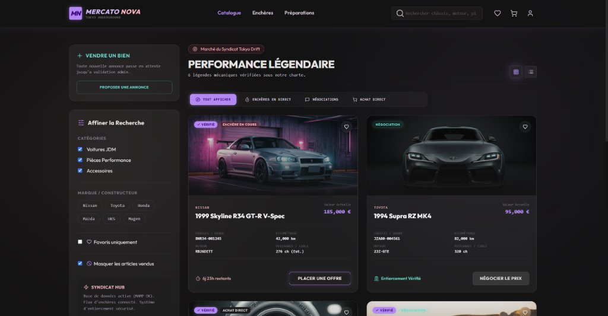
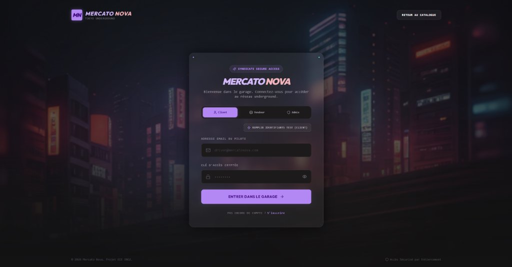

<div align="center">

# Mercato Nova — Projet Piscine ECE

**Specialized JDM Import E-Commerce Platform · Full-Stack React, PHP & MySQL**

[](https://react.dev/)
[](https://vitejs.dev/)
[](https://tailwindcss.com/)
[](https://www.php.net/)
[](https://www.mysql.com/)

[English](#english) • [Français](#francais)

</div>

---

<a id="english"></a>
## 🇬🇧 English

### GitHub Repository Link

[https://github.com/ECE-Groupe-1/projet-piscine](https://github.com/ECE-Groupe-1/projet-piscine)

**Mercato Nova** is an e-commerce platform specialized in importing JDM (Japanese Domestic Market) vehicles and performance parts. This project features a complete full-stack architecture with a **React** front-end and a **PHP / MySQL** back-end, integrating direct purchase, live auctions, and real-time price negotiation capabilities.

---

## Visual Overview

### 1. JDM Marketplace & Dynamic Catalog



> **Tokyo Underground Dark UI** — Built with React and Tailwind CSS, the main marketplace pairs a high-contrast dark theme with violet (`#bb86fc`) and coral accents. Users can browse verified JDM legends (e.g., *1999 Nissan Skyline R34 GT-R V-Spec*, *1994 Toyota Supra RZ MK4*) with technical specs (chassis code, engine, horsepower, mileage), live auction countdowns, multi-criteria sidebar filters (categories, brands, favorites, sold-item toggle), a real-time MAMP/SQL status widget (`Syndicat Hub`), and sale-mode tabs (`All`, `Live Auctions`, `Negotiations`, `Direct Buy`).

### 2. Role-Based Authentication Portal



> **Syndicate Secure Access** — A glassmorphic authentication view layered over a neon Tokyo skyline. It supports user login and registration, instant role switching (**Client**, **Seller**, **Admin**), password visibility toggling, and a one-click **test credential autofill** button for rapid demoing.

---

## Key Features

- **Dynamic JDM Catalog & Search**: Browse vehicles, performance parts, and accessories in **Grid** or **List** view; filter by category, brand (`Nissan`, `Toyota`, `Honda`, `Mazda`, `HKS`, `Mugen`), sale mode, favorites, or availability; search by model, chassis, or engine code; and submit new listings for admin approval.
- **Live Auctions & Anti-Sniping Engine**: Dedicated live-auction feed and bidding room backed by MySQL (`auctions/index.php`, `auctions/bid.php`), featuring real-time countdowns, simulated rival bidders, automatic anti-sniping time extensions on late bids, and instant winner transition to checkout.
- **Real-Time Price Negotiation & Direct Chat**: Submit offers with custom messages on negotiable listings, manage offers in a dedicated negotiation workspace (**Accept**, **Reject**, **Counter-Offer**), and exchange messages via a live-polling buyer/seller chat (with simulated JDM driver replies for testing).
- **Custom JDM Preparation Studio**: Interactive vehicle configurator allowing buyers to pair iconic chassis (*Skyline R34*, *RX-7 FD3S*, *Supra JZA80*, *Honda S2000*) with tuning stages (`Stage 1` to `Stage 4`) and Bento-grid hardware upgrades (turbo, suspension, aero, cockpit), computing live horsepower gains and total import cost before sending the custom build to checkout.
- **Multi-Method Checkout & Escrow Simulation**: Supports cart, won auctions, accepted negotiations, and custom builds with automatic shipping/import fees and 20% VAT calculation, simulated **Card** (auto-detecting Visa/Mastercard/Amex), **Bank Transfer**, and **Crypto** payments, a multi-step security verification flow, and SQL transaction persistence.
- **Real-Time Notifications & User Profile**: Header notification bell synced with MySQL (`notifications/get.php`, `read.php`), profile and avatar customization, password settings, and personal transaction history.
- **Role-Based Dashboards (Seller, Admin & Director)**:
  - **Seller Dashboard**: Manage listed inventory, monitor active auctions, respond to incoming negotiation offers, and track validated sales revenue.
  - **Admin & Director Workspace**: Moderate pending listings (approve/reject), ban/unban/delete user accounts, perform catalog CRUD, and review market analytics, audit logs, and live SQL transactions.

---

## 1. Server Installation (Backend)

To run the server-side API and database, you need **MAMP** (or XAMPP / WAMP).

1. Ensure MAMP is installed on your machine.
2. Move the **entire project folder** (`Projet_Piscine`) into your local web server's root directory:
   - **Windows (MAMP)**: `C:\MAMP\htdocs\Projet_Piscine`
   - **macOS (MAMP)**: `/Applications/MAMP/htdocs/Projet_Piscine`
3. Open MAMP and **start both Apache and MySQL servers**.

---

## 2. Database Configuration

The project includes a complete SQL script to generate the relational schema and seed test data.

1. Open **phpMyAdmin** in your browser (typically `http://localhost/phpMyAdmin` or `http://localhost:8888/phpMyAdmin`).
2. Go to the **Import** tab.
3. Select and execute `Projet_Piscine/database/init.sql`.
   *Note: This script automatically creates the `mercato_nova` database, all tables, and a complete set of sample users, products, auctions, negotiations, transactions, and notifications.*

---

## 3. Launching the Application (Frontend)

The user interface is built with React and Vite. Ensure **Node.js** is installed on your machine.

1. Open a terminal and navigate to the `frontend` directory:
   ```bash
   cd frontend
   ```
2. Install the project dependencies:
   ```bash
   npm install
   ```
3. Start the React development server:
   ```bash
   npm run dev
   ```
4. Open the URL displayed in your terminal (typically **http://localhost:5173**) in your web browser.

---

<details>
<summary><strong>🧪 Quick Demo Accounts & Test Flow</strong> (password: <code>password123</code>)</summary>

| Role | Email | Capabilities |
| :--- | :--- | :--- |
| **Buyer / Client** | `takumi.fujiwara@akina.jp` | Bid in live auctions, negotiate prices, configure JDM builds, checkout |
| **Seller** | `celestin@mercatonova.com` | Create listings, review & counter/accept incoming offers, track sales |
| **Admin / Director** | `gabin@mercatonova.com` | Moderate pending listings, manage users, inspect audit logs & SQL transactions |

**Suggested test flow:** Log in as **Takumi** (or use the one-click autofill button on the login screen), submit a negotiation offer on a vehicle, then switch to **Célestin** to accept or counter-offer in the Seller Dashboard and observe the real-time notification bell update.

</details>

---
---

<a id="francais"></a>
## 🇫🇷 Français

### Mercato Nova - Projet Piscine ECE

#### Lien du Repository Github

[https://github.com/ECE-Groupe-1/projet-piscine](https://github.com/ECE-Groupe-1/projet-piscine)

**Mercato Nova** est une plateforme d'e-commerce spécialisée dans l'import de véhicules et pièces JDM (Japanese Domestic Market). Ce projet propose une architecture complète avec un front-end en **React** et un back-end en **PHP / MySQL**, intégrant des fonctionnalités d'achat direct, d'enchères et de négociation en temps réel.

---

## Aperçu Visuel

### 1. Marketplace JDM & Catalogue Dynamique


> **Interface Dark "Tokyo Underground"** — Développée avec React et Tailwind CSS, la page principale associe un thème sombre à des accents néon violet (`#bb86fc`) et corail. On y retrouve les fiches véhicules vérifiées (*1999 Nissan Skyline R34 GT-R V-Spec*, *1994 Toyota Supra RZ MK4*) avec numéro de châssis, motorisation, puissance, kilométrage et compte à rebours en direct, les filtres latéraux (catégories, constructeurs, favoris, masquer les articles vendus), l'état en temps réel du serveur (`Syndicat Hub`), ainsi que les onglets par mode de vente (`Tout afficher`, `Enchères en direct`, `Négociations`, `Achat direct`).

### 2. Portail d'Authentification Sécurisée


> **Syndicate Secure Access** — Écran de connexion glassmorphique sur fond nocturne de Tokyo, permettant de basculer entre les rôles (**Client**, **Vendeur**, **Admin**), d'afficher/masquer le mot de passe, de créer un compte ou de pré-remplir les identifiants de test en un clic pour faciliter la démonstration.

---

## Fonctionnalités Complètes

- **Catalogue Dynamique & Recherche Avancée** : Affichage en mode **Grille** ou **Liste**, recherche instantanée (modèle, marque, châssis, moteur), filtres par catégorie (`Voitures JDM`, `Pièces Performance`, `Accessoires`), constructeur (`Nissan`, `Toyota`, `Honda`, `Mazda`, `HKS`, `Mugen`) et mode de vente, gestion des favoris, panier global et proposition de nouvelles annonces soumises à validation admin.
- **Enchères en Direct & Système Anti-Sniping** : Espace dédié aux enchères avec comptes à rebours en temps réel synchronisés en MySQL (`auctions/index.php`, `auctions/bid.php`), simulation d'enchérisseurs concurrents, prolongation automatique anti-sniping lors des offres de dernière seconde et passage direct au paiement en cas de victoire.
- **Négociation en Temps Réel & Messagerie Directe** : Envoi d'offres chiffrées avec message personnalisé, salle de négociation dédiée acheteur/vendeur (**Accepter**, **Refuser**, **Contre-offre**) et chat persistant avec rafraîchissement automatique (incluant des réponses simulées de pilotes JDM pour les tests).
- **Atelier de Préparation JDM sur Mesure** : Configurateur interactif permettant de choisir un châssis mythique (*Skyline R34*, *RX-7 FD3S*, *Supra JZA80*, *Honda S2000*), un niveau de préparation (`Stage 1` à `Stage 4`) et des pièces performance en grille Bento (turbo, châssis, aéro, cockpit), avec calcul en direct du gain de puissance et du devis d'importation avant envoi au paiement.
- **Tunnel de Paiement Multi-Méthodes & Entiercement** : Prise en charge des achats panier, enchères remportées, négociations acceptées et préparations sur mesure avec calcul des frais logistiques et de la TVA (20 %), paiement simulé par **Carte** (détection Visa/Mastercard/Amex), **Virement** ou **Crypto**, vérification sécurisée multi-étapes et enregistrement SQL.
- **Notifications Temps Réel & Espace Compte** : Cloche de notification connectée à la base MySQL (marquage lu en temps réel), personnalisation du profil et de l'avatar, modification du mot de passe et suivi de l'historique des transactions.
- **Tableaux de Bord par Rôle (Vendeur, Admin & Directeur)** :
  - **Espace Vendeur** : Gestion des annonces, suivi des enchères actives, traitement des offres reçues (accepter, refuser, contre-proposer) et statistiques de ventes.
  - **Espace Admin / Directeur** : Validation ou rejet des annonces en attente, modération des comptes (bannir, débannir, supprimer), gestion CRUD du catalogue, journal d'audit interactif, graphiques de marché et suivi en direct des transactions SQL.

---

## 1. Installation du Serveur (Backend)

Pour faire fonctionner la partie serveur et la base de données, vous avez besoin de **MAMP** (ou XAMPP / WAMP).

1. Assurez-vous d'avoir installé MAMP.
2. Déplacez **l'intégralité de ce dossier** (`Projet_Piscine`) dans le dossier racine de votre serveur web :
   - Sous Windows (MAMP) : `C:\MAMP\htdocs\Projet_Piscine`
   - Sous Mac (MAMP) : `/Applications/MAMP/htdocs/Projet_Piscine`
3. Ouvrez MAMP et **démarrez les serveurs Apache et MySQL**.

---

## 2. Configuration de la Base de Données

Le projet est livré avec un script SQL complet pour générer l'architecture et les données de test.

1. Allez sur **phpMyAdmin** depuis votre navigateur (généralement `http://localhost/phpMyAdmin` ou `http://localhost:8888/phpMyAdmin`).
2. Allez dans l'onglet **Importer**.
3. Importez le fichier situé dans `Projet_Piscine/database/init.sql` et exécutez-le.
   *Note : Ce script crée automatiquement la base de données `mercato_nova`, les tables, et ajoute un jeu complet d'utilisateurs et de produits de test.*

---

## 3. Lancement de l'Application (Frontend)

L'interface utilisateur a été développée avec React et Vite. Assurez-vous d'avoir **Node.js** installé sur votre machine.

1. Ouvrez un terminal et naviguez dans le dossier `frontend` du projet :
   ```bash
   cd frontend
   ```
2. Installez les dépendances du projet :
   ```bash
   npm install
   ```
3. Démarrez le serveur de développement React :
   ```bash
   npm run dev
   ```
4. Ouvrez le lien affiché dans le terminal (généralement **http://localhost:5173**) dans votre navigateur web.

---

<details>
<summary><strong>🧪 Comptes de Test & Scénario Rapide</strong> (mot de passe : <code>password123</code>)</summary>

| Rôle | Email | Accès |
| :--- | :--- | :--- |
| **Client / Acheteur** | `takumi.fujiwara@akina.jp` | Enchères live, négociations, configurateur de préparation, paiement |
| **Vendeur** | `celestin@mercatonova.com` | Création d'annonces, gestion des offres reçues, suivi des ventes |
| **Administrateur / Directeur** | `gabin@mercatonova.com` | Validation d'annonces, modération utilisateurs, journal d'audit & transactions SQL |

**Scénario rapide :** Connectez-vous en tant que **Takumi** (ou utilisez le bouton de remplissage automatique sur l'écran de connexion), soumettez une offre sur une annonce en négociation, puis connectez-vous en tant que **Célestin** pour accepter ou faire une contre-offre depuis l'Espace Vendeur tout en observant la cloche de notifications en temps réel.

</details>
